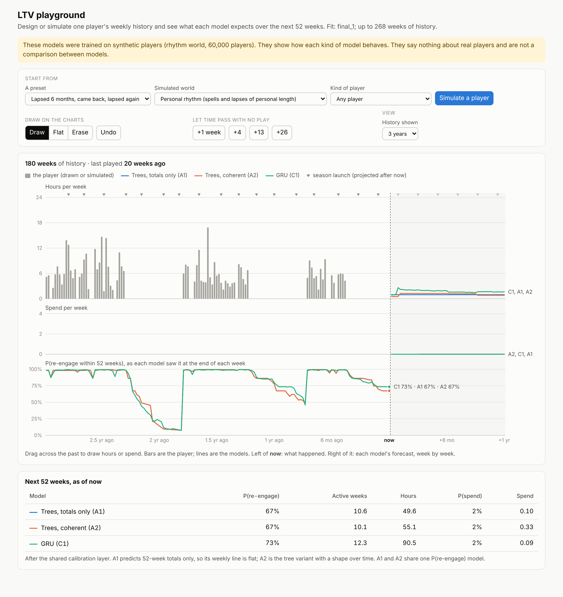

# The playground: one player, every model, on your own machine

A small local web page for getting a feel for the models. You draw or simulate one
player's weekly history, and each model's view of the next 52 weeks updates as you edit.
It runs the same code as the pipeline. It is a way to look at models, not to evaluate
them: that is `50_eval`.



## Run it

Once, from a checkout of this repo (Python 3.10 or newer; no Spark or Java needed):

```bash
pip install -e .
```

Train small demo models on **synthetic** players (about 10 minutes on 4 cores, once):

```bash
python -m ltv.playground --train-demo --no-serve
```

Start it:

```bash
python -m ltv.playground
```

It opens `http://127.0.0.1:8765/` in your browser. Stop it with Ctrl+C. The models live in
`./artifacts/playground`, which Git ignores.

| Option | What it does |
| --- | --- |
| `--bundle DIR` | Use the fits in another folder |
| `--train-demo` | Train the synthetic demo into the bundle folder first (`--world markov` for the other synthetic world, `--users N` for more or fewer players) |
| `--raw` | Show raw model outputs, without the calibration layer |
| `--fit final_2` | Load another fit (default: `final_1`, else `final_2`, else `tune`) |
| `--port N`, `--no-browser` | |

## What you can do

- **Start from a preset**: steady player; lapsed 6 months, came back, lapsed again; serial
  returner; hours fading; new player; gone a year; back this week.
- **Simulate a player** from one of the two synthetic worlds, optionally of a kind (playing
  now, lapsed, has come back from a long lapse). The 52 weeks that followed in the
  simulation are drawn as dashed bars. They are one random draw, not what a model should
  have said.
- **Draw**: drag across the past on the hours or spend panel. *Draw* follows the pointer,
  *Flat* repeats the height where you started, *Erase* clears weeks. Undo with the button
  or Ctrl+Z.
- **Let time pass**: add 1, 4, 13 or 26 weeks with no play, and watch each model's
  P(re-engage) fall.

What it shows:

| Where | What |
| --- | --- |
| Hours and spend panels, right of *now* | Each model's forecast for each of the next 52 weeks |
| Bottom panel, left of *now* | Each model's P(re-engage within 52 weeks) as it stood at the end of each past week: a fresh score of the history up to that week |
| Table | The five 52-week outputs per model, as of now |
| Small triangles | Season launches: real ones in the past, projected ones after now |

A1 predicts 52-week totals only, so its weekly line is flat. A2 is the tree variant with a
shape over time. A1 and A2 share one P(re-engage) model, so those lines coincide.

## Using the real models

After the Databricks run, the artifact folder is a bundle as it stands. Copy these files
from `<artifact_path>` on the volume to a local folder, keeping the layout:

```
trees/suite_final_1.pkl            the tree models
seq/C1/model_final_1.pkl           the GRU (and any other variant you ran)
examples/calibration.pkl           written by 55_examples: the shared calibration layer
examples/calendar.csv              written by 55_examples: the season calendar
examples/meta.json                 written by 55_examples: which fit, and which week is "now"
```

```bash
python -m ltv.playground --bundle /path/to/that/folder
```

**Keep real models on your machine.** They are trained on player data. Do not commit them
(`artifacts/` is ignored by Git) and do not publish them. That is also why this is a local
page and not a GitHub Pages site: Pages only serves static files, so the models and the
feature code would have to be rewritten in JavaScript and kept in step with the pipeline,
and a Pages site is public by default.

Only open bundles you made yourself: the files are Python pickles.

## How it works

- "Now" is the bundle's origin week: the week the fit was built to be scored at. Your
  history is placed so that it ends there, which keeps the calendar and the tenure the
  models see inside what they were trained on. The longest history is that many weeks.
- A history starts at its first week with hours or spend, as in the data.
- The trees are scored on features rebuilt from the history by `np_features.py`, the
  implementation the tests keep equal to the SQL. The GRU reads the history directly.
- Scoring a past week reads only the weeks up to it (tested).
- Platform and country are fixed (one platform, one country). The page does not vary them.
- Players quiet for more than 104 weeks are outside the population the models were trained
  on. The page flags them.

Code: `src/ltv/playground/` (`core.py` is the logic and is what `tests/test_playground.py`
exercises; `server.py` is a thin standard-library HTTP layer bound to 127.0.0.1;
`index.html` is the page, with no external resources).

## Limits

- **The demo models are trained on synthetic players.** They show how each kind of model
  responds to a history. They say nothing about real players and are not a comparison
  (`AGENTS.md`, rule 3). The demo fits are also small: 60,000 players, default settings.
- **The simulator is always synthetic**, also with real models loaded.
- One player at a time, no saving, no authentication. It is a personal tool.
